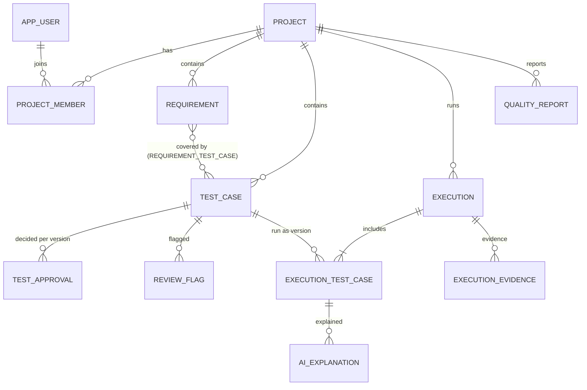

# Phase 1 — API Contracts and Database Schema (agreed)

These files are the **contract between team members**. Code in Phase 2 must match them; a change needs a PR that updates the contract file first and is approved by the owners of both sides.

| Interface (M2 §4.1) | Contract file | Provider → Consumer |
|---|---|---|
| I1 Public REST API | [`docs/contracts/public-api.openapi.yaml`](../contracts/public-api.openapi.yaml) | core-backend → web-ui |
| I2 AI Assistance API | [`docs/contracts/ai-service-api.openapi.yaml`](../contracts/ai-service-api.openapi.yaml) | ai-service → core-backend |
| I4 Execution messages | [`docs/contracts/messages/*.schema.json`](../contracts/messages/) | core-backend ⇄ runner-worker via RabbitMQ |
| I6 Data | [`db/schema.sql`](../../db/schema.sql) | PostgreSQL → core-backend only |

## 1. RabbitMQ topology

| Name | Type | Durable | Producer → Consumer | Notes |
|---|---|---|---|---|
| `execution.requests` | queue | yes | Job Publisher → Runner Worker | prefetch 1, manual ack after `ExecutionFinished` is published; DLX → `execution.requests.dlq` |
| `execution.events` | queue | yes | Runner Worker → Execution Event Listener | carries `ExecutionHeartbeat` and `ExecutionFinished` (field `type`); ack only after DB commit; DLX → `execution.events.dlq` |
| `execution.requests.dlq`, `execution.events.dlq` | queue | yes | — | messages that fail schema validation 3 times |

All messages: `content_type=application/json`, `delivery_mode=2` (persistent), `message_id` = body `messageId`.

## 2. Execution state machine (P10, only the orchestrator moves it)

```
QUEUED ──first heartbeat──> RUNNING ──ExecutionFinished──> PASSED | FAILED | INTERRUPTED
  │                            │
  │                            └──watchdog (no heartbeat 15 s or time limit + 5 s)──> INTERRUPTED
  └──(reserved, not in M3 UI)──> CANCELLED
```
Terminal states never change again. A late/duplicate event for a terminal execution is logged and acked (ignored).

### Mapping runner output → status (ADR-006, QAS-7)

| `ExecutionFinished.outcome` | JUnit XML | Execution status | `termination_reason` | Per-test `result_status` |
|---|---|---|---|---|
| COMPLETED | valid and contains every requested test | **FAILED** if any test failed/errored, else **PASSED** | COMPLETED | from the XML |
| COMPLETED | missing, unparseable, or a requested test is absent | INTERRUPTED | INVALID_REPORT | NOT_RUN for missing ones |
| TIMEOUT | any | INTERRUPTED | TIMEOUT | from partial XML if valid, else NOT_RUN |
| RESOURCE_LIMIT | any | INTERRUPTED | RESOURCE_LIMIT | NOT_RUN |
| ERROR | any | INTERRUPTED | INTERNAL_ERROR | NOT_RUN |
| *(no message, heartbeats stop)* | — | INTERRUPTED | RUNNER_LOST | NOT_RUN |

Valid = parses as JUnit XML, `testsuite` counts match the `testcase` elements, and each test is matched to a requested `testCaseId` by the generated test file name `test_tc_<testCaseId>_v<version>.py`. The DB also enforces `PASSED/FAILED ⇒ termination_reason = COMPLETED` (constraint `ck_pass_fail_needs_completed`).

## 3. Role → permission matrix (Auth & Access Filter)

| Action | DEVELOPER | QA_ASSISTANT | TEAM_LEAD | ADMIN |
|---|:-:|:-:|:-:|:-:|
| Create project | ✅ | ❌ | ✅ | ❌ |
| Add requirement | ✅ | ❌ | ❌ | ❌ |
| Generate / add / edit tests | ✅ | ✅ | ❌ | ❌ |
| Flag a test | ✅ | ✅ | ✅ | ❌ |
| Approve / reject | ✅ | ❌ | ✅ | ❌ |
| Run approved tests | ✅ | ✅ | ✅ | ❌ |
| Read results, logs, coverage, risks | ✅ | ✅ | ✅ | ❌ |
| Request AI explanation | ✅ | ✅ | ❌ | ❌ |
| Generate quality report | ❌ | ❌ | ✅ | ❌ |

All project-scoped actions also require project membership. ADMIN is reserved for FR-13 (future).

## 4. Data model (14 M2 entities + 1 technical table)



## 5. Additions to the M2 design made while fixing contracts → record as **ADR-009** in M3

| # | Addition | Why |
|---|---|---|
| 1 | `POST /api/projects/{id}/tests` (manual test entry), `GET /api/projects`, `GET /api/me`, `GET /api/projects/{id}/executions` | M2 §3.2 requires manual entry during AI outage; UI needs list screens; QAS-1 measures "latest results" |
| 2 | `ApprovalDecision.version` + `409 VERSION_CONFLICT` | Makes ADR-005 version-bound approval enforceable over HTTP |
| 3 | `503 QUEUE_UNAVAILABLE` | Broker down at publish time: transaction is rolled back, no orphan QUEUED row |
| 4 | `termination_reason` values `INVALID_REPORT`, `RESOURCE_LIMIT`, `INTERNAL_ERROR`; `outcome: RESOURCE_LIMIT` | M2 named reasons in prose only; needed as enums |
| 5 | Table `processed_message`; columns `execution.time_limit_seconds`, `execution_evidence.truncated` | Idempotent event handling (R-011), watchdog needs the limit, OI-008 cap must be visible |
| 6 | DB CHECK constraints on terminal states | Second line of defence for ASR-3 |

No container, boundary, style or ASR changes.
